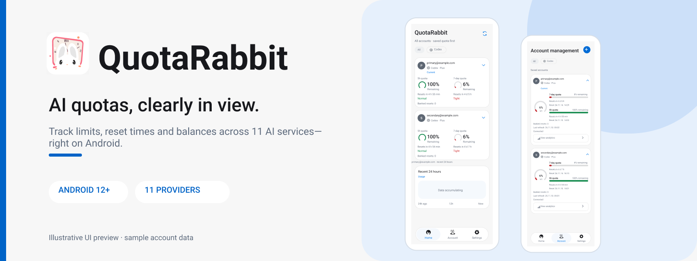
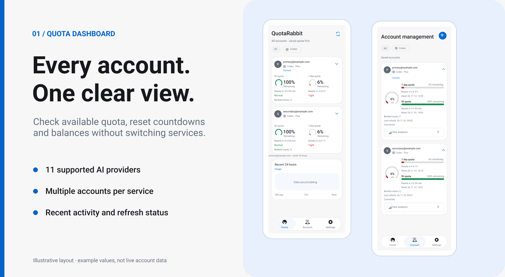
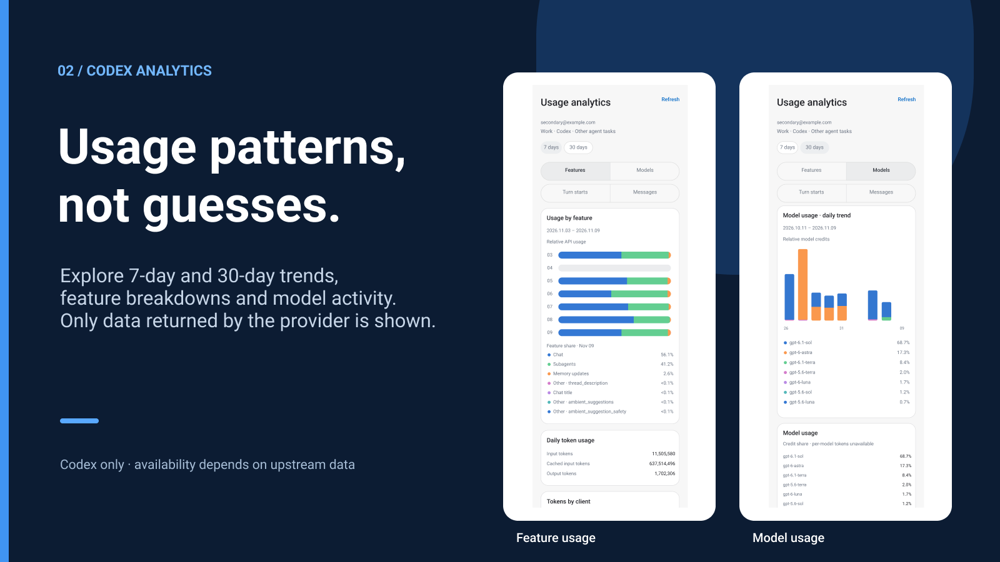

# QuotaRabbit

<a href="./README.md">한국어</a> · <a href="./README.en.md">English</a> · <a href="./README.zh-CN.md">简体中文</a>

 

QuotaRabbit is an Android app for checking quotas and balances across 11 AI services, including Codex. Connect your accounts to see how much quota remains and when it resets. You can also keep an eye on usage from a home-screen widget or notification.

**[Download APK (v1.0.0)](https://github.com/S-Laplace/QuotaRabbit/releases/download/v1.0.0/quotarabbit-1.0.0.apk)** · [All releases](https://github.com/S-Laplace/QuotaRabbit/releases)

## Screenshots

*The accounts and figures shown in these images are examples.*

## Features

### Accounts and quotas

View accounts grouped by service, and expand a card to see recent activity. You can add more than one account per service and choose which one to mark as current. The available details—remaining quota, reset time or balance—depend on the service.

### Usage analytics

Codex accounts have 7-day and 30-day views of model and feature usage. These detailed charts are currently limited to Codex. Missing data isn't replaced with estimates.

### Widgets and notifications

Choose the accounts and quota fields shown in a resizable home-screen widget. You can also receive low-quota alerts or keep the current status in your notifications.

## Supported services

| Sign-in method | Services |
| --- | --- |
| Device code | Codex, Grok |
| OAuth | Claude, Antigravity (Google) |
| API key | DeepSeek, z.ai Coding Plan, z.ai API, MiniMax, Kimi Code API |
| In-app sign-in | Cursor, Kimi |

Sign-in methods and available usage data vary by service. If a session expires, you may need to connect the account again.

## Installation

Requires Android 12 or later.

1. Download an APK from [GitHub Releases](https://github.com/S-Laplace/QuotaRabbit/releases).
2. Open the APK on your phone. If Android asks, allow your browser or file manager to install apps from this source.
3. Launch QuotaRabbit and connect your accounts.

To update an existing installation, the APK must be signed with the same key as the installed version.

## Things to know

QuotaRabbit displays usage data supplied by each service. It schedules refreshes roughly every 15 minutes, though Android battery restrictions may delay them. You can refresh manually in the app. Changes to a provider's login flow or API may also affect what the app can show.

## Privacy

Account connections and usage history are stored on your device, with connection data encrypted at rest. The app has no cloud sync, advertising SDK or remote usage analytics. It connects to each provider when you sign in or request usage data.

## License and credits

QuotaRabbit is based on [CodexMeter](https://github.com/KyoMio/CodexMeter), with changes to its interface and features. The original copyright notice and MIT License are retained in [LICENSE](LICENSE). Some provider response handling draws on [CodexBar](https://github.com/steipete/CodexBar).

QuotaRabbit is not an official app of the supported services.
