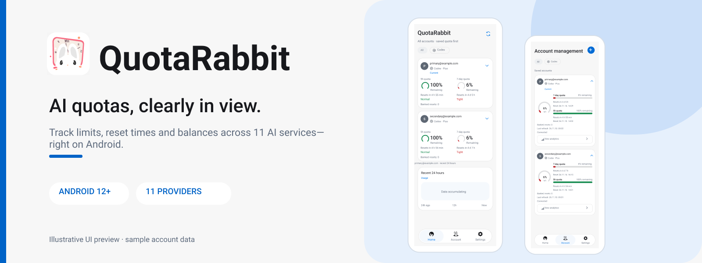
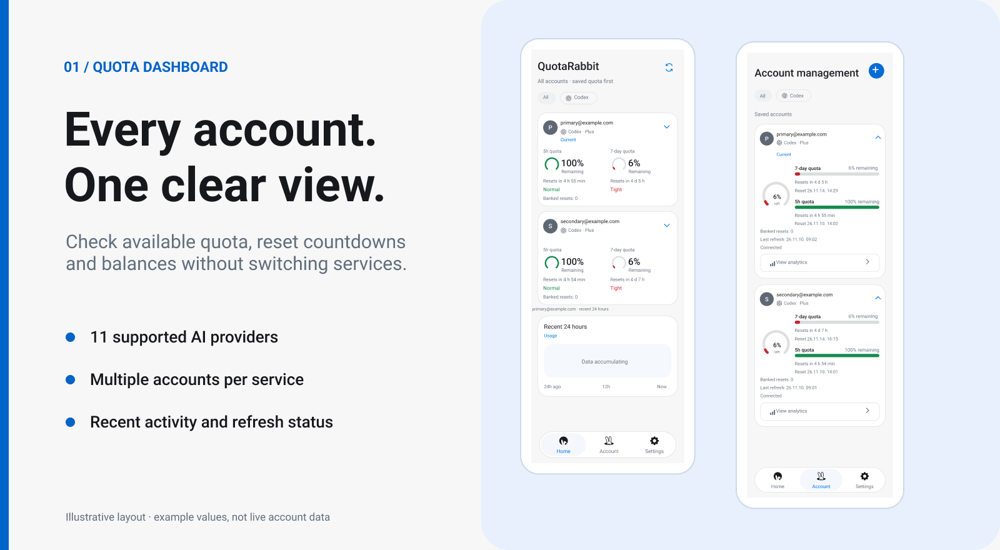
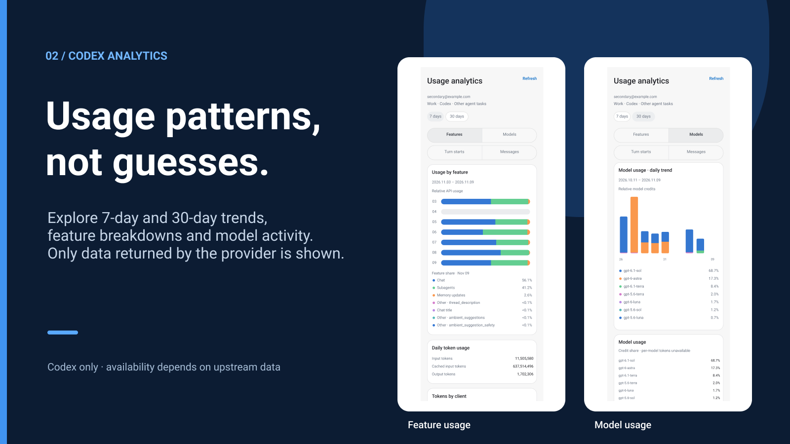

# QuotaRabbit

<p align="center"></p>

<p align="center"><a href="./README.md">한국어</a> · <a href="./README.en.md">English</a> · <a href="./README.zh-CN.md">简体中文</a></p>

<p align="center"><a href="./LICENSE"></a> </p>

QuotaRabbit은 **여러 AI 서비스의 남은 사용 한도와 잔액을 Android 휴대전화에서 확인하는 앱**입니다. Codex를 비롯한 11개 서비스의 계정을 추가하면 남은 한도, 재설정까지 남은 시간과 마지막 갱신 상태를 한곳에서 볼 수 있습니다. 홈 화면 위젯과 알림에서도 필요한 정보를 확인할 수 있습니다.

[APK 릴리스 페이지](https://github.com/S-Laplace/QuotaRabbit/releases) · [소스코드](https://github.com/S-Laplace/QuotaRabbit)

## 화면 미리보기

<p align="center"></p>

*이미지 속 계정과 수치는 화면 구성을 보여주기 위한 예시입니다.*

## 주요 기능

### 계정과 사용 한도

홈 탭에는 등록한 계정이 서비스별로 표시됩니다. 계정 카드를 펼치면 최근 사용량과 활동 기록을 볼 수 있습니다. 서비스가 제공하는 데이터에 따라 한도 비율, 재설정 시간 또는 잔액이 나타납니다.

계정 탭에서는 같은 서비스의 여러 계정을 등록하고 이름, 강조 색상, 알림 설정을 관리할 수 있습니다. 서비스마다 현재 사용할 계정을 지정하는 기능도 있습니다. 새로고침에 실패하면 마지막으로 정상 조회한 값과 갱신 상태를 함께 보여줍니다.

### Codex 사용량 분석

Codex 계정은 최근 7일과 30일의 모델별·기능별 사용량, 토큰 관련 지표를 확인할 수 있습니다. API에서 받지 못한 수치나 날짜를 임의로 채우지는 않습니다. 상세 분석은 현재 모든 서비스에서 지원되는 기능이 아닙니다.

<p align="center"></p>

*분석 화면의 수치 역시 예시 데이터입니다.*

### 위젯과 알림

홈 화면 위젯은 크기를 조절할 수 있으며, 표시할 계정과 한도 항목도 선택할 수 있습니다. 상시 알림과 한도 경고는 설정에서 관리합니다.

데이터는 WorkManager로 주기적으로 갱신합니다. 기본 간격은 약 15분이지만 Android의 절전 정책에 따라 지연될 수 있습니다. 최신 값이 필요하면 앱에서 직접 새로고침하면 됩니다.

## 지원 서비스

| 서비스 | 계정 연결 방법 |
| --- | --- |
| Codex | 외부 브라우저의 기기 코드 인증 |
| Claude | OAuth |
| Antigravity | Google OAuth |
| DeepSeek | API 키 |
| z.ai Coding Plan | API 키 |
| z.ai API | API 키 |
| MiniMax | API 키 |
| Cursor | 앱 내 로그인 세션 |
| Kimi | 앱 내 로그인 세션 |
| Kimi Code API | API 키 |
| Grok | 외부 브라우저의 기기 코드 인증 |

서비스마다 로그인 방식과 제공하는 사용량 항목이 다릅니다. 인증이 만료되거나 API가 바뀌면 일부 정보를 가져오지 못할 수 있습니다. QuotaRabbit은 토큰 사용량이나 비용을 임의로 계산해 표시하지 않습니다.

## 설치

**Android 12 이상**에서 사용할 수 있습니다.

1. [GitHub Releases](https://github.com/S-Laplace/QuotaRabbit/releases)에 게시된 서명 APK를 다운로드합니다.
2. APK를 열어 설치합니다. 필요하면 브라우저나 파일 관리자의 ‘알 수 없는 앱 설치’ 권한을 허용합니다.
3. 앱을 실행하고 계정을 연결합니다.

새 저장소에 아직 APK가 게시되지 않았다면 아래 방법으로 직접 빌드할 수 있습니다. 기존 설치본을 업데이트하려면 이전과 동일한 서명 키로 만든 APK가 필요합니다.

## 소스에서 빌드

Android Studio의 JDK 환경, Android SDK 37, 저장소에 포함된 Gradle Wrapper가 필요합니다. Windows에서 `settings.gradle.kts`가 있는 폴더를 열고 실행합니다.

```powershell
.\gradlew.bat :app:assembleDebug
.\gradlew.bat :app:testDebugUnitTest
```

디버그 APK는 `app/build/outputs/apk/debug/`에 만들어집니다. 릴리스 APK는 `.\gradlew.bat :app:assembleRelease`로 빌드할 수 있지만, 배포하려면 서명 설정이 필요합니다. `RELEASE_KEYSTORE_PATH`, `RELEASE_STORE_PASSWORD`, `RELEASE_KEY_ALIAS`, `RELEASE_KEY_PASSWORD` 환경 변수를 사용할 수 있습니다. 키스토어와 비밀번호는 저장소에 올리지 마세요.

패키지명은 `com.alice.quotarabbit`입니다.

## 데이터와 개인정보

계정 세션은 Android Keystore 기반 AES-GCM으로 암호화해 기기에 저장합니다. 사용 기록과 설정도 기기에 보관하며, 클라우드 동기화·광고 SDK·원격 분석 수집 기능은 넣지 않았습니다.

로그인과 사용 한도 조회에는 서비스 제공자와의 네트워크 통신이 필요합니다. 표시되는 내용은 서비스 API, 인증 상태, Android의 백그라운드 제한에 영향을 받습니다. 특히 Codex 상세 분석에 쓰이는 일부 엔드포인트는 안정적인 공개 API가 아니므로 나중에 변경될 수 있습니다.

## 라이선스와 출처

QuotaRabbit은 [CodexMeter](https://github.com/KyoMio/CodexMeter)를 바탕으로 화면과 기능을 수정·확장한 프로젝트입니다. 원저작자의 저작권 고지와 MIT 라이선스는 [LICENSE](LICENSE)에 유지했습니다. 서비스별 응답 처리에는 [CodexBar](https://github.com/steipete/CodexBar)를 일부 참고했습니다.

QuotaRabbit은 해당 AI 서비스의 공식 앱이 아닙니다.
