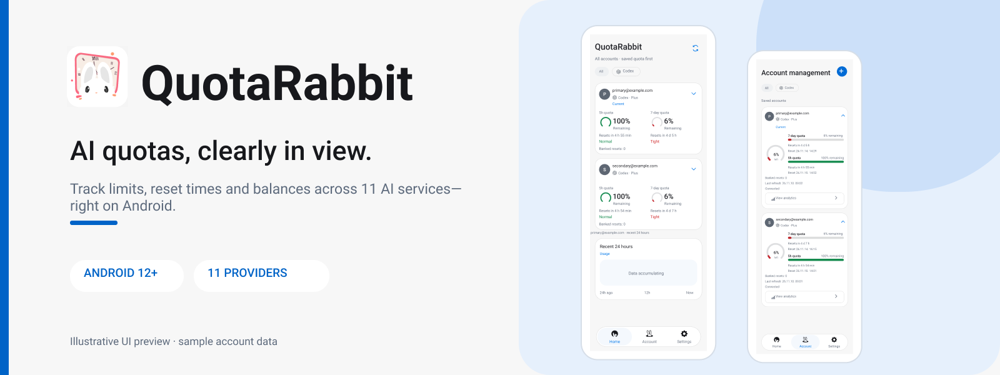
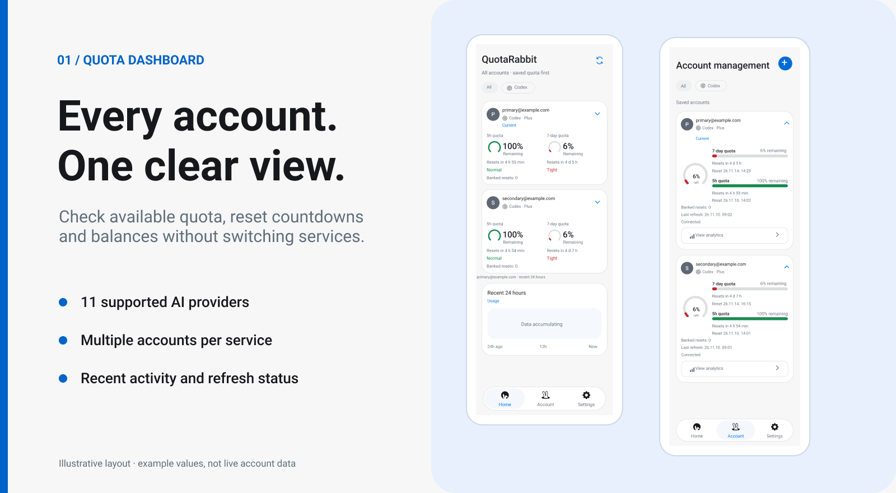
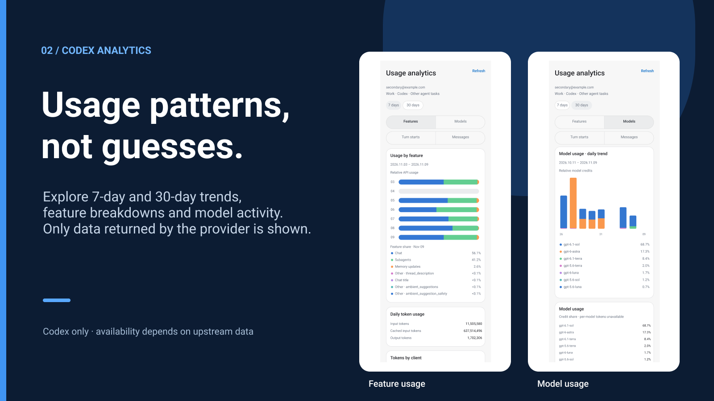

# QuotaRabbit

<a href="./README.md">한국어</a> · <a href="./README.en.md">English</a> · <a href="./README.zh-CN.md">简体中文</a>

 

QuotaRabbit 是一款 Android 应用，可以查看 Codex 等 11 个 AI 服务的额度和余额。连接账号后，你可以集中查看剩余额度以及下次重置时间。常用信息也能显示在桌面小组件或通知栏中。

**[下载 APK（v1.0.0）](https://github.com/S-Laplace/QuotaRabbit/releases/download/v1.0.0/quotarabbit-1.0.0.apk)** · [所有版本](https://github.com/S-Laplace/QuotaRabbit/releases)

## 界面预览

*图片中的账号和数值仅供演示。*

## 主要功能

### 账号与额度

账号按服务商分组展示，展开卡片即可查看近期活动记录。同一个服务商可以添加多个账号，并指定当前使用的账号。剩余额度、重置时间和余额等信息会根据服务商提供的数据有所不同。

### 用量分析

Codex 账号可以查看最近 7 天或 30 天的模型用量和功能用量。目前这项详细分析仅支持 Codex，缺失的数据不会用估算值补齐。

### 小组件与通知

桌面小组件可以调整大小，并选择要显示的账号和额度信息。你还可以设置额度不足提醒，或在通知栏中保留当前状态。

## 支持的服务商

| 登录方式 | 服务商 |
| --- | --- |
| 设备码授权 | Codex、Grok |
| OAuth | Claude、Antigravity（Google） |
| API 密钥 | DeepSeek、z.ai Coding Plan、z.ai API、MiniMax、Kimi Code API |
| 应用内登录 | Cursor、Kimi |

各服务商的登录方式和可查询的数据不同。登录状态过期后，可能需要重新连接账号。

## 安装

需要 Android 12 或更高版本。

1. 从 [GitHub Releases](https://github.com/S-Laplace/QuotaRabbit/releases) 下载 APK。
2. 在手机上打开 APK。如果 Android 提示，请允许浏览器或文件管理器安装来自此来源的应用。
3. 启动 QuotaRabbit，连接你的账号。

升级已有安装时，新 APK 必须使用与旧版本相同的签名密钥。

## 使用须知

QuotaRabbit 展示的是各服务商返回的用量数据。应用默认约每 15 分钟安排一次刷新，但 Android 的省电限制可能导致延迟。你也可以在应用内手动刷新。如果服务商修改了登录方式或 API，部分信息可能暂时无法获取。

## 隐私

账号连接信息和用量记录保存在设备本地，其中连接信息会加密存储。应用不提供云同步，也不集成广告 SDK 或远程用量分析功能。登录和查询用量时，应用仍需与对应服务商联网通信。

## 许可证与致谢

QuotaRabbit 基于 [CodexMeter](https://github.com/KyoMio/CodexMeter) 修改和扩展了界面及功能。原作者的版权声明和 MIT 许可证保留在 [LICENSE](LICENSE) 中。部分服务商的响应处理参考了 [CodexBar](https://github.com/steipete/CodexBar)。

QuotaRabbit 不是这些服务商的官方应用。
